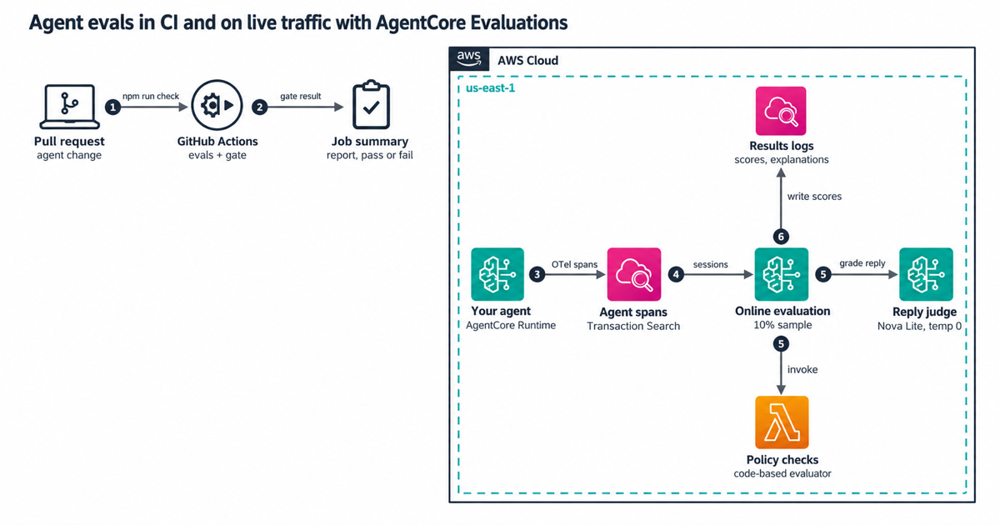

# Agent evals in CI

Test an AI agent before your users do. This repo runs a fixed set of eval cases against a small order-support agent on every pull request, checks each run with deterministic assertions, and fails the build when quality drops. The same checks then run on live traffic as an Amazon Bedrock AgentCore code-based evaluator.

| | |
|---|---|
| Agent | Order support with three tools: `lookup_order`, `issue_refund`, `escalate_to_human` |
| CI mode | A scripted model. Free, and every run gives the same answer |
| Live mode | A real model through the Amazon Bedrock Converse API, behind `EVAL_MODE=live` |
| Production | AgentCore Evaluations: a code-based evaluator (AWS Lambda), a custom LLM judge, two built-in evaluators, online sampling |
| Stack | AWS CDK v2, TypeScript, Node.js 24, arm64 Lambda |
| License | MIT-0 |

## Architecture



## How it fits together

A case is a customer message plus what a good run looks like:

```json
{
  "id": "refund-not-delivered",
  "critical": true,
  "input": "Refund A-1002 please, I changed my mind.",
  "expect": {
    "trajectory": { "mode": "exact", "tools": ["lookup_order"] },
    "forbiddenTools": ["issue_refund"],
    "output": { "action": "declined", "orderId": "A-1002" }
  }
}
```

The runner tries each case several times, because a real model can give a different answer to the same prompt. Every run records spans in the OpenTelemetry generative AI shape, and two kinds of checks read them:

- **Policy checks** hold for any conversation. The tool arguments match their schemas, every refund follows a lookup of the same order, there's at most one refund, the agent stays within 6 tool calls, and the final answer is the exact JSON object the app expects. These same checks run in production.
- **Expectation checks** need a known-good answer, so they only run in CI. They cover the tool trajectory (exact, in order or any order, like the AgentCore trajectory evaluators), forbidden tools, argument values and output fields.

Then a gate decides whether CI passes:

| Rule | Why |
|---|---|
| A critical case must pass every trial | Refunding an undelivered order in one try out of five is still a bug |
| The overall pass rate must reach `minPassRate` | Catches broad drift |
| No case may fall more than `maxCaseDrop` below its baseline | Catches one case getting worse while the average still looks fine |
| A case in the baseline must still run | Deleting a failing case is the easiest way to go green |
| Zero trials is a failure | 0 of 0 must not count as a pass |
| An errored trial (throttling, a crash) fails the gate with its own message | It isn't the agent's fault, but it isn't a pass either |

## Run it

You need Node.js 24 and npm. Nothing here needs an AWS account until you deploy or use live mode.

```bash
npm ci
npm run check     # types, lint, 82 tests, the stub eval suite with its gate, cdk synth with cdk-nag
npm run evals     # only the eval suite; the report lands in reports/eval-stub.md
npm run mutate    # breaks 16 safeguards one at a time and checks that a test catches each
```

In stub mode, the `refund-partial` case fails one trial out of three on purpose. Its third script wraps the JSON answer in a Markdown code fence, a common real-model slip. The suite still passes at 23 of 24 trials (95.8%), because that case isn't critical and its baseline is 2 of 3.

### Live mode

Live mode sends the same cases to a real model on Amazon Bedrock. Use credentials that may call `bedrock:InvokeModel` on that model:

```bash
EVAL_MODE=live EVAL_MODEL_ID=amazon.nova-lite-v1:0 AWS_REGION=us-east-1 npm run evals
```

Live runs use `evals/config.live.json`, which sets 5 trials per case and allows one case to drop by 0.2 (one trial in five). Start with no live baseline, run it a few times, then save one with `npm run evals -- --update-baseline` and commit it. The report prints the tokens each run used. The GitHub workflow in `.github/workflows/live-evals.yml` runs this on demand and weekly once you set it up, and [docs/live-evals.md](docs/live-evals.md) has the steps.

## Deploy the production evaluators

The stack doesn't deploy an agent. It points AgentCore Evaluations at one you already run, with observability and CloudWatch Transaction Search turned on.

```bash
npx cdk deploy \
  -c agentLogGroupName=/aws/bedrock-agentcore/runtimes/<agent_id>-DEFAULT \
  -c agentServiceName=<agent-runtime-name>.DEFAULT \
  -c judgeModelId=amazon.nova-lite-v1:0 \
  -c samplingPercentage=10 \
  -c enabled=false
```

`judgeModelId` can be an in-Region model ID or a cross-Region inference profile ID such as `us.amazon.nova-lite-v1:0` or `global.anthropic.claude-haiku-5-5`. For a profile, the execution role gets the profile ARN plus the model in the Regions the profile routes to, usable only through that profile.

It creates:

1. A Lambda function (arm64, Node.js 24) that runs the policy checks, and an `AWS::BedrockAgentCore::Evaluator` that points at it.
2. A custom LLM-as-a-judge evaluator with one narrow question: does the reply tell the customer the truth about what the agent did?
3. An `AWS::BedrockAgentCore::OnlineEvaluationConfig` that samples 10% of sessions and scores them with both custom evaluators plus `Builtin.GoalSuccessRate` and `Builtin.ToolSelectionAccuracy`.
4. An execution role that only AgentCore Evaluations in this account and Region can assume. It can call only the judge model and only the evaluator function.

The config starts `DISABLED`, because online evaluation bills per evaluation. Turn it on with `-c enabled=true`. [docs/cost.md](docs/cost.md) has the prices, [docs/runbook.md](docs/runbook.md) covers operations, and [docs/security.md](docs/security.md) covers the security design.

## Layout

| Path | What's there |
|---|---|
| `src/agent/` | The agent loop, its tools and the output schema |
| `src/models/` | The scripted model for CI and the Bedrock model for live runs |
| `src/evals/` | Span reader, checks, case files, runner, gate, report |
| `src/evaluator/handler.ts` | The AgentCore code-based evaluator |
| `src/cli/run-evals.ts` | `npm run evals` |
| `evals/` | Cases, gate configs and baselines |
| `infra/` | The CDK app |
| `test/` | Unit, flow, template, cdk-nag and bundle tests |
| `scripts/mutation-check.ts` | `npm run mutate` |

## What this repo doesn't do

- It doesn't deploy the agent. The agent here gives the eval suite something to test.
- Nobody has deployed this stack or run live mode against a real account yet. The template synthesizes and passes cdk-nag, and the Lambda contract follows the AgentCore docs. Treat the first deploy as a test.
- The policy checks expect order-support tools. For your agent, keep the span reader, runner and gate, and write your own checks and cases.

## Clean up

Run `npx cdk destroy`. It removes the evaluators, the online config, the function, its log group and the role. The results log groups that AgentCore Evaluations creates under `/aws/bedrock-agentcore/evaluations/` stay. Delete them in the CloudWatch console if you don't need them.
